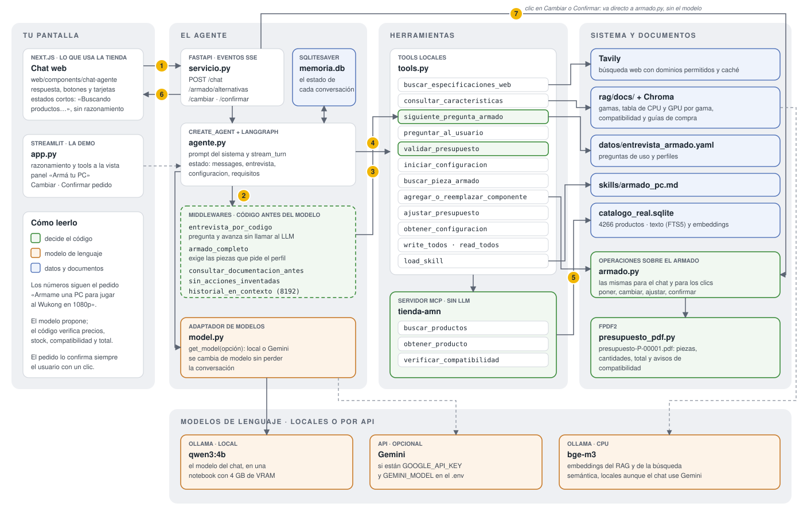

# Asistente de compra AMN — Grupo 10

Agente conversacional para tienda.amn.com.ar (Modelos de Lenguaje, UTN FRM 2026).
Qué hace y cómo trabajamos: [`CLAUDE.md`](CLAUDE.md). Plan por fases y estado: [`PLAN.md`](PLAN.md).

Sigue la estructura del agente investigador que mostró la cátedra ([fmaya02/AgenteInvestigadorVerFinal](https://github.com/fmaya02/AgenteInvestigadorVerFinal)): `create_agent` de LangChain, tools con estado, memoria con `SqliteSaver`, RAG sobre Chroma, skills y UI en Streamlit (demo/banco de pruebas). `chat_lmstudio.py` está copiado de ese repositorio. Lo nuestro se suma: servidor MCP de la tienda, armado de PC, servicio HTTP + componente de chat web para la tienda y fine-tuning.

El proyecto trabaja con **cuatro gamas** (`baja`, `media`, `alta` y `premium`). El estado de cada paso está en `PLAN.md`. En el paso 10 (código mergeado en `main`; falta la medición con el modelo local), la entrevista del armado usa la versión 1 (`siguiente_pregunta_armado` devuelve la pregunta y `preguntar_al_usuario` muestra los botones) y `validar_presupuesto` interpreta jerga, números en palabras, «2,8M» y «y medio». En `paso-11-otros-problemas` se agregaron el recorte de contexto conservando fuentes para `MODEL_NUM_CTX=8192` (`agente.py`), presupuesto como texto en `iniciar_configuracion`, experimento HyDE en `evaluacion/rag.py` y la guía `docs/AJUSTES_OLLAMA.md`.

### Principio de diseño: El modelo propone, el código verifica
Para evitar alucinaciones en decisiones críticas, este proyecto no le permite al LLM inventar la gama de los componentes. La clasificación en las cuatro gamas (`baja`, `media`, `alta`, `premium`) se hace por código puro leyendo una tabla estricta (`tabla_cpu_gpu_por_gama.md`).
* **Origen de los datos:** Los puntajes de rendimiento salen empíricamente de los rankings *GPU Benchmarks Hierarchy 2026* y *CPU Benchmarks Hierarchy 2026* de Tom's Hardware.
* **Cortes de gama:** Los umbrales (ej: 42 y 58 fps en 1440p para GPU; 50 y 75 puntos relativos para CPU) fueron definidos en conjunto por el Grupo 10 y TodoComputacion, cruzando las métricas de rendimiento con los componentes citados en la base de conocimiento (`gamas.md`).
* **Hardware legacy y exclusiones:** Los componentes antiguos se trajeron a la escala actual mediante factorizaciones y regresiones lineales (R² ≈ 0.98). Si un procesador o placa no tiene datos oficiales, se excluye de la tabla y el sistema responde «sin datos», bloqueando cualquier intento del LLM de adivinar por nombre o antigüedad.
* **Trazabilidad:** Toda la matemática detrás de las estimaciones y el error típico está documentada y reproducible mediante el script `construir_tabla_gamas.py` y el archivo `gamas_trazabilidad.csv`.

## Diagrama del flujo del agente



Los números siguen un pedido como «Quiero armar una PC para jugar al Wukong en 1080p»:

1. El cliente escribe en el chat web. `servicio.py` lo manda al agente y devuelve eventos: la respuesta, los botones y estados cortos, sin el razonamiento.
2. El middleware ve que nombró un juego: el modelo busca primero sus requisitos (`buscar_especificaciones_web`) y el código los ubica en una gama con la tabla de CPU y GPU.
3. La entrevista la sigue el código. Lo que el pedido ya dice (uso, pantalla) no se pregunta. Cada pregunta sale con sus botones; un clic avanza sin llamar al modelo.
4. Con el perfil listo, el modelo propone: elige piezas entre los candidatos que devuelven las tools de armado.
5. El código verifica: el servidor MCP busca en el catálogo y aplica las reglas de compatibilidad. Precios, stock y total nunca los calcula el LLM.
6. La configuración queda en el estado de la conversación (`memoria.db`) y viaja a la pantalla como tarjetas, con el total y el reporte de compatibilidad.
7. Los botones Cambiar y Confirmar pedido van directo a `servicio.py` y `armado.py`, sin pasar por el modelo. Confirmar genera el PDF con el presupuesto.

Verde: decide el código. Naranja: modelos de lenguaje. Azul: datos y documentos.

## Requisitos

- Python 3.11 o superior
- Un modelo local con **tool calling**, servido por [Ollama](https://ollama.com) o LM Studio
- Un modelo de embeddings local para el RAG (por defecto `bge-m3`)
- `TAVILY_API_KEY` ([Tavily](https://app.tavily.com)) para la búsqueda web

## Puesta en marcha

```bash
uv sync
```

Quien prefiera `pip`: `pip install -r requirements.txt` dentro de un entorno virtual.

```bash
cp .env.example .env
```

```bash
ollama pull qwen3:4b
```

Para el RAG hace falta además el modelo de embeddings:

```bash
ollama pull bge-m3
```

```bash
uv run python -m mcp_tienda.ingesta.cargar --fuente prueba
```

El catálogo de prueba ya viene generado en `datos/catalogo_prueba/`. Si se tocan las semillas o el generador, se regenera con `uv run python -m mcp_tienda.ingesta.generar_catalogo_prueba` (un test avisa si quedó desactualizado).

### Elegir el modelo

Se configura en el `.env`, sin tocar código (`model.py`):

| Modelo | Configuración |
|---|---|
| Ollama (local, por defecto) | `MODEL_PROVIDER=ollama` y `MODEL_NAME=qwen3:4b` |
| LM Studio (local) | `MODEL_PROVIDER=lmstudio`, `MODEL_NAME=<id exacto del modelo cargado>` y `LMSTUDIO_BASE_URL=http://localhost:1234/v1` |
| Modelo afinado (local) | El mismo proveedor, con `MODEL_NAME=<nombre del modelo afinado>` |
| Gemini por API (opcional) | `GOOGLE_API_KEY=<tu clave>` y `GEMINI_MODEL=<id del modelo>` |

**Selector de modelo (local o Gemini):** si están `GOOGLE_API_KEY` y `GEMINI_MODEL` en `.env`, se puede elegir entre el modelo local y Gemini sin perder la conversación (todos los modelos comparten `memoria.db`):

- **Streamlit (`app.py`):** selector «Modelo» en la barra lateral (se aplica al próximo mensaje).
- **Consola (`agente.py`):** `uv run python agente.py --modelo gemini` (por defecto `local`).
- **Servicio HTTP (`servicio.py`) y chat web:** campo opcional `"modelo"` en `POST /chat`, validado contra `AGENTE_MODELOS_PERMITIDOS` (por defecto solo `"local"`, para proteger la cuota de API en producción; en desarrollo se puede usar `AGENTE_MODELOS_PERMITIDOS=local,gemini`). En el componente web (`web/components/chat-agente/`), el selector solo aparece en modo desarrollo (`NEXT_PUBLIC_MODO_DESARROLLO=1` o prop `modoDesarrollo`).
- Los **embeddings del RAG** siguen siendo siempre locales (`bge-m3`), incluso al chatear con Gemini.

### Interfaces: demo y producto

- **Streamlit (`app.py` — demo y banco de pruebas):** muestra todo el recorrido (razonamiento, llamadas a tools, resultados y panel «Armá tu PC» con tarjetas, botones «Cambiar» y «Confirmar pedido», y selector de modelo).
- **Chat web (`web/components/chat-agente/` + `servicio.py` — producto para la tienda):** muestra la respuesta, tarjetas de productos y armado, preguntas con botones y estados cortos («Pensando…», «Buscando productos…», «Buscando en internet…»). No expone el razonamiento ni los argumentos de las tools. El selector de modelo aparece solo en modo desarrollo.
- **Consola (`agente.py`):** cliente por terminal para pruebas rápidas (`--modelo local` o `--modelo gemini`).

## Usar y medir

| Qué | Comando |
|---|---|
| Banco de pruebas en Streamlit (chat + panel «Armá tu PC») | `uv run streamlit run app.py` |
| **Servicio del agente** (lo que integra la tienda) | `uv run python -m uvicorn servicio:app --port 8000` |
| Página de prueba en Next.js con el chat (necesita Node.js) | `cd web`, `npm install`, `npm run dev` |
| Chat por consola | `uv run python agente.py` |
| Indexar la documentación del RAG (cada vez que cambie `rag/docs/`) | `uv run python -m rag.ingest` |
| Tests (sin LLM, sin internet) | `uv run pytest` |
| Smoke con el LLM local (Ollama) | `uv run pytest -m ollama` |
| RAG con embeddings reales | `uv run pytest -m embeddings` |
| Búsqueda web real (Tavily) | `uv run pytest -m tavily` |
| Exactitud de la extracción | `uv run python -m evaluacion.extraccion --detalle` |
| Calidad del catálogo real (qué se pudo leer, qué corregir) | `uv run python -m evaluacion.calidad_catalogo` |
| Agente sobre pedidos simples | `uv run python -m evaluacion.agente_simple` |
| Armado de PC de punta a punta, sin entrevista (con el modelo local) | `uv run python -m evaluacion.armado_punta_a_punta --semillas 1 2 3` |
| Armado de PC de punta a punta, con la entrevista (usuario simulado) | `uv run python -m evaluacion.armado_con_entrevista --semillas 1 2 3` |
| Reglas de compatibilidad con el catálogo: cobertura, sin datos y falsos compatibles | `uv run python -m evaluacion.reglas_catalogo` |
| Reparto del presupuesto por gama (y escribir `rag/docs/reparto_presupuesto.md`) | `uv run python -m evaluacion.reparto_presupuesto --escribir-doc` |
| Guía de compatibilidad: regenerar el bloque de números desde las reglas | `uv run python -m mcp_tienda.armado.guia_compatibilidad --escribir-doc` |
| Evaluación del RAG (`--solo-vectores` o experimento `--hyde`) | `uv run python -m evaluacion.rag [--solo-vectores | --hyde]` |

Para medir con un catálogo distinto del `.env`, anteponé `AMN_CATALOGO_DB=ruta/a/la/base.sqlite` al comando. Las mediciones con el modelo local tardan varios minutos por corrida.

Los resultados de las evaluaciones quedan en `evaluacion/resultados/`.

### Primera prueba en la interfaz

1. *«Armame una PC para jugar con $1.200.000»* → carga la skill, planifica con TODOs, entrevista por uso con botones (`preguntar_al_usuario`), valida montos (`validar_presupuesto`) y arma la configuración: aparecen las tarjetas a la derecha.
2. *«Cambiá la placa de video por una más potente»* → cambia solo esa pieza (la configuración quedó guardada del turno anterior). También se puede con el botón **Cambiar** de la tarjeta.
3. **Confirmar pedido** → lo hace el usuario con un clic; el asistente no puede confirmarlo.

Para explicar («¿qué es una gama media?») y para ajustar el presupuesto sin bajar de gama usa los documentos de `rag/docs/` (borradores indexados con `uv run python -m rag.ingest`). El primero es `tabla_cpu_gpu_por_gama.md`.

### Qué se le entrega a la tienda

El módulo que suma el grupo es **solo el agente**. La página y su lógica son de la tienda (Next.js + NestJS).

| Entregable | Dónde |
|---|---|
| El agente como servicio HTTP, con respuesta en flujo de eventos | `servicio.py` |
| El componente del chat (botón flotante + panel), sin dependencias fuera de React | `web/components/chat-agente/` |
| Guía para integrarlo: qué mostrar y qué no, el puente en NestJS, cómo cargar el armado | `docs/GUIA_INTEGRACION.md` |
| Mejoras propuestas a la API y al armado de PC | `docs/MEJORAS_API_ARMADO_PC.md` |
| Ajustes de Ollama / LM Studio (notebook 4 GB y escritorio 8 GB) | `docs/AJUSTES_OLLAMA.md` |

La página de `web/` es una maqueta para probar el chat; a la tienda va solo la carpeta del componente.
Copiar `web/.env.example` a `web/.env.local` para indicar dónde está el servicio.

## Estructura

```
├── servicio.py       servicio HTTP del agente (FastAPI): es lo que integra la tienda
├── web/              página de prueba en Next.js y el componente del chat
├── docs/             guía de integración, ajustes de Ollama (4 GB / 8 GB) y mejoras a la API
├── app.py            banco de pruebas en Streamlit: chat + panel de configuración
├── agente.py         prompt, create_agent, streaming, conversaciones, consola
├── tools.py          estado (EstadoTienda) y tools locales
├── model.py          get_model() y get_embeddings()
├── chat_lmstudio.py  cliente de LM Studio (de la cátedra)
├── armado.py         operaciones sobre la configuración (las usan el chat y los clics)
├── rag/              store.py, ingest.py y docs/ (nuestros documentos)
├── skills/           armado_pc.md
├── mcp_tienda/       servidor MCP (servidor.py), puente (cliente.py), catálogo e ingesta del catálogo
│   └── armado/       reglas de compatibilidad, candidatos (filtros), gamas, entrevista (preguntas y perfil),
│                     montos (jerga, números en palabras, «2,8M» y «y medio»), requisitos de juegos y guía de compatibilidad
├── datos/            esquemas de atributos y catálogo de prueba (precios inventados)
├── evaluacion/       conjuntos y scripts de métricas
├── finetuning/
└── tests/
```

Se generan al usar la app (no se versionan): `memoria.db`, `conversaciones.txt`, `rag/chroma_db/`, `datos/catalogo.sqlite`, `datos/pedidos.sqlite`, `datos/caches/`.

Para reiniciar los datos, cerrá la app y borrá `memoria.db`, `conversaciones.txt` y `rag/chroma_db/`.

## Solución de problemas

| Síntoma | Causa probable |
|---|---|
| «No existe datos/catalogo.sqlite» | Falta `python -m mcp_tienda.ingesta.cargar --fuente prueba` |
| «Falta la base vectorial del RAG» | Falta `python -m rag.ingest` (y antes, escribir los documentos) |
| «Falta TAVILY_API_KEY» | Clave ausente en el `.env` |
| El agente no usa las tools | El modelo no soporta tool calling, es demasiado chico o el contexto es corto (`MODEL_NUM_CTX`) |
| La gama figura «sin datos» | El modelo no está en `rag/docs/tabla_cpu_gpu_por_gama.md` |

## Cuando llegue el catálogo real

- **Export CSV/Excel:** `uv run python -m mcp_tienda.ingesta.cargar --fuente csv --archivo datos/catalogo_real/export.csv` (ajustar el mapeo de columnas en `mcp_tienda/ingesta/fuentes/export_csv.py`). `datos/catalogo_real/` no se sube al repo.
- **API:** definir `AMN_API_URL` y `AMN_API_COOKIE` en `.env` (los precios solo se ven con una sesión iniciada en la tienda) y correr `uv run python -m mcp_tienda.ingesta.cargar --fuente api`. Las piezas de PC se leen con las convenciones de carga de la tienda (`mcp_tienda/ingesta/formato_amn.py`).
- **Calidad del catálogo:** `uv run python -m evaluacion.calidad_catalogo` (no necesita sesión) informa qué atributos del armado se pudieron leer y deja en `evaluacion/resultados/calidad_catalogo_avisos.csv` los productos que no siguen la convención, para corregirlos en la tienda.

El checklist completo está en `PLAN.md`.
